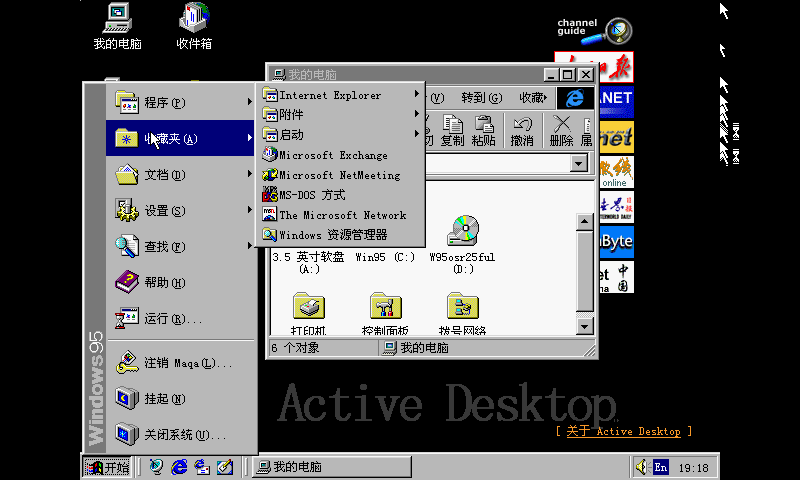

# Tiny386

## Introduction
Tiny386 is an x86 PC emulator written in C99, optimized for **RISC-V 32-bit microcontrollers (MCUs)** such as the **ESP32-S31** and **ESP32-P4**. The goal is to run Windows 9x/NT on a single-chip RISC-V MCU.

The same sources can also be built and run in interpreted mode on an **amd64** host. The amd64 build exists purely for development and testing — the final target is always the MCU.

The core of the project is a built-from-scratch, simple and stupid i386 cpu emulator. Some features are missing, e.g. debugging, hardware tasking and some permission checks, but it should be able to run most 16/32 bit software. To boot modern linux kernel and windows, some 486 and 586 instrutions are added. The cpu emulator is kept in ~6K LOC. There is also an optional x87 fpu emulator.

To assemble a complete PC system, we have ported many peripherals from TinyEMU and QEMU, it now includes:
 - 8259 PIC
 - 8254 PIT
 - 8042 Keyboard Controller
 - CMOS RTC
 - Cirrus CL-GD5446 VGA with 2D acceleration
 - IDE Disk Controller
 - NE2000 ISA Network Card
 - 8257 ISA DMA
 - PC Speaker
 - Adlib OPL2 (optional)
 - SoundBlaster 16

For firmware, the BIOS/VGABIOS comes from SeaBIOS, so the emulator runs real x86 firmware. Tiny386 also supports booting linux kernel directly, without traditional BIOS. The idea comes from JSLinux, and it uses a small stub code called linuxstart.

Tiny386 now supports i686, MMX, SSE (up to SSSE3) and amd64 (64bit long mode only). As these features are optional, they may be safely disregarded if not required.

## 2D acceleration
The Cirrus CL-GD5446 blitter is emulated and accelerated:
 - **ESP32-P4**: the on-chip **PPA** 2D accelerator is used for plain forward blits.
 - **amd64 host**: an **OpenCL** backend accelerates blits (on a GPU or CPU device).
 - A portable fallback CPU blitter implements all 16 ROP operations, transparent color compare and 8/16-bpp color expand, keeping rendering correct on every target.

Windows 95 in 16-bit color (800x480) on the Cirrus CL-GD5446 — dragging and repainting windows now renders correctly with acceleration enabled:



## Demo
See [here](https://hchunhui.github.io/tiny386)

## Build

### ESP32 (primary target)
Both RISC-V 32 targets (ESP32-S31 / ESP32-P4) use **ESP-IDF 6.0.x**.

Supported boards:
- `JC4880P443` (ESP32-P4 Rev1.3 360MHz, 800x480)

To build and flash:
```sh
scripts/build.sh patch_idf_60  # apply patches to ESP-IDF 6.0.x
cd src/esp
idf.py -DBOARD=jc4880p443 update-dependencies build
idf.py flash
```

Online flasher for esp chips: https://espressif.github.io/esptool-js

### amd64 host (development / testing only)
The host build runs the same emulator in interpreted mode, which is useful to test changes quickly before flashing the MCU. Requires the SDL2 development library (`libsdl2-dev`), and `libslirp` for networking.

```sh
./run_amd64_tiny386.sh                 # native SDL2 frontend, Windows 95 by default
./run_amd64_tiny386.sh tiny386_pc.ini  # boot DOS instead
```

The very same code can also be run as a RISC-V 32 target under `qemu-riscv32`:
```sh
./run_rv32_tiny386.sh                  # ESP32-P4 core under qemu-riscv32 + SDL2 viewer
```

For a minimal build without any optional features:
```sh
gcc -O3 -Isrc src/*.c -o tiny386_headless -lm
```

The legacy host frontends (rawdraw, plain SDL, win32, WASM) still live in the tree, but are not the project's focus.

For details, please refer to `.github/workflows/build.yml` and `Makefile`.

Pre-built binaries: [here](https://github.com/hchunhui/tiny386/releases)

## Usage

- Prepare an ini file
```ini
[pc]
; set path to BIOS and VGA BIOS
bios = bios.bin
vga_bios = vgabios.bin

; set memory size and VGA memory size
mem_size = 32M
vga_mem_size = 2M

; fda/fdb for floppy disks (optional)
fda = floppy.img

; hda/hdb/hdc/hdd for hard disks (optional)
; cda/cdb/cdc/cdd for CD-ROM disks (optional)
hda = win95.img
cdb = win95_cd.iso

; "fill_cmos" fixes "MS-DOS compatibility mode" in win9x, but it breaks winNT...
fill_cmos = 1

; force 8-dot mode (640 pixel wide in text mode) if set to 1
vga_force_8dm = 0
```
- Run
```sh
./tiny386 config.ini
./tiny386 -kvm config.ini  # run with KVM (build with `make USE_CPUABS=y`)
```

Press "Ctrl + ]" to grab/ungrab the keyboard and mouse. Press "Ctrl + [" to show/hide OSD (On Screen Display). In OSD mode, the floppy/CD-ROM disk can be changed on the fly.

## ESP32 port
Supported boards (ESP-IDF 6.0.x):
- `JC4880P443` (ESP32-P4 Rev1.3 360MHz, 800x480)

ESP32-S31 is the next RISC-V 32 target; together with the ESP32-P4 it shares the same emulator core and the ESP-IDF 6.0.x toolchain.

### Build and Flash
You can find the pre-built flash image `flash_image_JC4880P443.bin` from [here](https://github.com/hchunhui/tiny386/releases).
The pre-built image can be flashed directly to offset 0.

Online flasher for esp chips: https://espressif.github.io/esptool-js

To build and flash manually:
```sh
scripts/build.sh patch_idf_60  # apply patches to ESP-IDF 6.0.x
cd src/esp
idf.py -DBOARD=jc4880p443 update-dependencies build
idf.py flash
```

### Configure
All files should be put in a SD card with FAT/exFAT file system. The ini file should be `tiny386.ini` and put in the root directory.
Please refer to `src/esp/tiny386.ini`.

Alternative usage: `bios.bin` `vgabios.bin` `vmlinux.bin` and `linuxstart.bin` can be put in corresponding flash partition. Other files can be put in the `storage` flash partition. Please refer to `src/esp/partition.csv`.

### Keyboard/Mouse Input

- Forward over WIFI

`wifikbd` is used to forward keyboard/mouse events to the dev board over WIFI:
```
(ESP32 board: listen on TCP port 9999) <--- WIFI ---> AP <--- WIFI/Wire ---> (PC: ./wifikbd esp_board_addr 9999)
```

- USB hid (experimental)

Add the following config:
```
[esp]
enable_usb = 1
```

Note: DO NOT enable USB and WIFI at the same time on RAM-constrained boards.

## Troubleshooting

### "0 bytes of memory" during Windows 95 setup
Use "setup /im" to bypass memory check.

### "protection error" during Windows 95 startup
Use [patcher9x](https://github.com/JHRobotics/patcher9x).

### NE2000 doesn't work
Manually set the IRQ to 9(or 2).

### freeze during Windows NT4/2000/XP startup
Use `fill_cmos = 0` in the config ini file.

## License
The cpu emulator and the project as a whole are both licensed under the BSD-3-Clause license.

Adlib emulation is an optional part of the project, and it requires the library fmopl which is licensed under the LGPL.
Use `make USE_FMOPL=n` to build without adlib emulation.

SeaBIOS is distributed under the GNU LGPL-3 license. Releases ship pre-built `bios.bin` / `vgabios*.bin`; the corresponding source is the upstream [SeaBIOS](https://github.com/coreboot/seabios) plus the `scripts/seabios/` config and patch, which are also included in the release bundle.

Some parts ported from QEMU/TinyEMU are under the MIT license.
